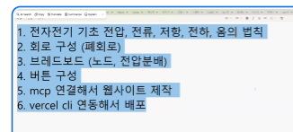
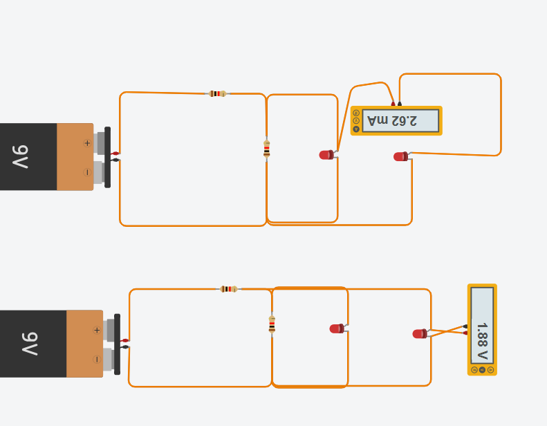
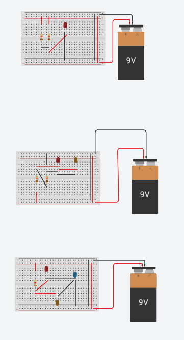
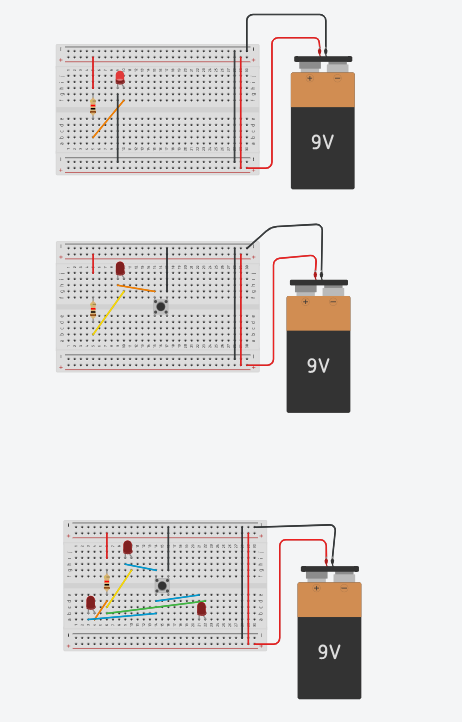

# 5일차 — 전기 기초부터 회로 실습, 쇼핑몰 제작·배포까지



> 이 노트는 오늘 수업 여섯 가지를 강의 형식으로 정리한 것입니다.
> 1~5번은 오르카(Orca) 폴더에 실습 결과가 남아 있어서 그 결과까지 함께 정리했고,
> 6번(Vercel CLI 배포)은 실습 기록이 없어 내용만 정리했습니다.

| # | 주제 | 실습 기록 |
|---|---|---|
| 1 | 전자전기 기초 — 전압, 전류, 저항, 전하, 옴의 법칙 | `slides/` 강의자료 01강 |
| 2 | 회로 구성 (폐회로) | `팅커캐드/회로도 1.png` |
| 3 | 브레드보드 (노드, 전압분배) | `팅커캐드/회로도2.png` |
| 4 | 버튼 구성 | `팅커캐드/회로도3.png` |
| 5 | MCP 연결해서 웹사이트 제작 | `아두이노/`(아두마트), `electric/`(오르카 일렉트릭, 진행 중) |
| 6 | Vercel CLI 연동해서 배포 | 기록 없음 — 개념 정리 |

---

## 1강. 전자전기 기초 — 전압, 전류, 저항, 전하, 옴의 법칙

자, 오늘 첫 시간입니다. 회로를 만지기 전에 **말부터 정확히** 맞춰 봅시다. 전기에서 쓰는 단어 다섯 개만 제대로 알면, 앞으로 나오는 회로는 전부 이 다섯 개의 조합입니다.

### 학습 목표
- 전하·전류·전압·저항이 각각 **무엇을 세는 양인지** 말할 수 있다.
- 옴의 법칙 `V = I × R` 로 셋 중 하나를 계산할 수 있다.

### 1-1. 전하 (Q, 단위 C 쿨롱)
모든 물질은 원자로 되어 있고, 원자 안에는 **+전하(양성자)** 와 **−전하(전자)** 가 있습니다.
같은 전하끼리는 밀어내고, 다른 전하끼리는 끌어당깁니다. 금속처럼 전자가 쉽게 움직이는 물질을 **도체**, 고무처럼 잘 못 움직이는 물질을 **부도체**라고 합니다.

### 1-2. 전류 (I, 단위 A 암페어)
전류는 **1초 동안 한 지점을 지나가는 전하의 양**입니다. `I = Q / t`
수도관으로 비유하면 "1초에 흐르는 물의 양"입니다.
> 주의: 관례상 전류는 + → − 방향으로 그립니다. 실제 전자는 반대(− → +)로 움직입니다.

### 1-3. 전압 (V, 단위 V 볼트)
전압은 두 점 사이의 **전기적 높이 차이**, 즉 전하를 밀어주는 힘입니다.
물탱크 비유에서 **수위 차**에 해당합니다. 높이 차가 없으면 물이 흐르지 않듯, 전압 차가 없으면 전류도 흐르지 않습니다.
> 전압은 항상 "어디와 어디 사이"로 말합니다. 그래서 멀티미터로 전압을 잴 때는 부품 **양 끝에 나란히(병렬로)** 댑니다.

### 1-4. 저항 (R, 단위 Ω 옴)
저항은 **전류가 흐르기 어려운 정도**입니다. 수도관이 가늘수록 물이 덜 흐르는 것과 같습니다.
저항기의 색 띠로 값을 읽습니다(예: 갈-검-빨 = 1 kΩ, 빨-빨-갈 = 220 Ω).

### 1-5. 옴의 법칙
세 양은 한 식으로 묶입니다.

```
V = I × R        I = V / R        R = V / I
```

**예제.** 5 V 전원에 220 Ω 저항 하나 → `I = 5 / 220 ≈ 0.023 A = 23 mA`

**예제 (LED 보호저항).** 9 V 배터리로 빨간 LED(약 1.9 V)를 10 mA로 켜려면?
저항이 맡아야 할 전압은 `9 − 1.9 = 7.1 V`, 그러므로 `R = 7.1 / 0.01 = 710 Ω` → 가까운 규격인 **750 Ω 또는 1 kΩ** 을 씁니다.

### 확인 문제 (OX)
1. 전압은 한 점만 있어도 정해진다. → **X** (항상 두 점 사이)
2. 저항이 두 배가 되면 같은 전압에서 전류는 절반이 된다. → **O**
3. 전류계는 부품과 나란히 연결한다. → **X** (전류계는 직렬, 전압계는 병렬)

> **했던 것:** `slides/` 프로젝트로 비전공자용 강의자료 01강 「전기란 무엇인가」(12장, manim 애니메이션 4개)를 만들어 공개했습니다.
> 강의 페이지: https://worksenddl2-source.github.io/electronics-basics-slides/
> 02강(전압·전류·저항), 03강(옴의 법칙)은 아직 준비 중입니다.

---

## 2강. 회로 구성 — 폐회로

### 학습 목표
- 전류가 흐르려면 왜 **닫힌 길(폐회로)** 이 필요한지 설명할 수 있다.
- 전류계와 전압계를 올바른 위치에 연결할 수 있다.

### 핵심 개념
전류는 전원의 **+극에서 나와 부품을 거쳐 −극으로 돌아오는** 한 바퀴 길이 있어야 흐릅니다.
길이 한 군데라도 끊기면(**개회로**) 전류는 0입니다. 스위치는 바로 이 길을 끊었다 이었다 하는 장치입니다.

- **직렬 연결:** 한 줄로 이어짐 → 모든 부품에 **같은 전류**, 전압은 나눠 가짐
- **병렬 연결:** 갈래로 나뉨 → 모든 갈래에 **같은 전압**, 전류는 나눠 가짐

### 실습 결과 (팅커캐드)



9 V 배터리 + 저항 + LED 2개로 폐회로를 만들고 멀티미터로 측정했습니다.
- **위 회로:** 멀티미터를 **전류 모드로 길 중간에 직렬로** 끼워 넣어 **2.62 mA** 를 읽었습니다.
- **아래 회로:** 멀티미터를 **전압 모드로 LED 양 끝에 병렬로** 대서 **1.88 V** 를 읽었습니다. 빨간 LED가 켜질 때 걸리는 전압(순방향 전압)이 약 1.8~2 V라는 것과 맞습니다.

> 생각해 볼 것: 9 V 중 LED가 1.88 V를 가져갔다면 나머지 전압은 어디로 갔을까요? → 저항들이 나눠 가졌습니다. 그래서 저항이 LED에 흐르는 전류를 제한해 LED가 타지 않습니다.

---

## 3강. 브레드보드 — 노드와 전압분배

### 학습 목표
- 브레드보드 내부에서 **어느 구멍끼리 이어져 있는지** 알 수 있다.
- 노드와 전압분배 개념으로 회로를 읽을 수 있다.

### 브레드보드 내부 구조
- **가운데 영역:** 세로 5칸(a–e, f–j)이 한 묶음으로 연결됩니다. 가운데 홈을 사이에 두고 위·아래는 **끊겨 있습니다.**
- **양 옆 전원 레일(+/−):** 가로로 길게 연결됩니다. 빨간 줄은 +, 파란(검은) 줄은 −(GND)로 씁니다.

### 노드 (Node)
도선으로 이어져 **전압이 같은 점들의 묶음**을 노드라고 합니다. 브레드보드의 세로 5칸 한 묶음이 곧 하나의 노드입니다.
회로를 읽을 때는 "부품 다리가 어느 노드에 꽂혔는가"만 보면 됩니다.

### 전압분배
저항 두 개를 직렬로 이으면 전압이 **저항 크기에 비례해** 나뉩니다.

```
V_out = V_in × R2 / (R1 + R2)
```

**예제.** 9 V, R1 = R2 = 1 kΩ → 가운데 노드 전압 = `9 × 1/2 = 4.5 V`
**예제.** 9 V, R1 = 2 kΩ, R2 = 1 kΩ → `9 × 1/3 = 3 V`

### 실습 결과 (팅커캐드)



같은 9 V 전원으로 브레드보드 위에 세 가지 배치를 만들었습니다.
1. 저항 2개 + LED 1개
2. 저항 2개 + LED 2개 (빨강·노랑)
3. 저항 + LED 3개 (빨강·파랑·노랑)

전원 레일에서 +/−를 끌어오고, 점퍼선으로 노드끼리 이어 같은 회로를 여러 모양으로 꾸며 봤습니다.

---

## 4강. 버튼 구성

### 학습 목표
- 택트 스위치(푸시 버튼)의 다리 연결 구조를 알 수 있다.
- 버튼으로 폐회로를 열고 닫아 LED를 제어할 수 있다.

### 택트 스위치 구조
다리가 4개지만 실제로는 **두 쌍**입니다. 마주 보는 쌍은 원래 붙어 있고, **버튼을 누를 때만 두 쌍이 이어집니다.**
그래서 브레드보드 **가운데 홈을 가로질러** 꽂는 것이 정석입니다.

### 실습 결과 (팅커캐드)



1. **기본 회로:** 9 V → 저항 → LED → GND. 버튼 없이 항상 켜짐
2. **버튼 추가:** 길 중간에 버튼을 넣어 **누를 때만 폐회로**가 되어 LED가 켜짐
3. **LED 3개 + 버튼:** 버튼 하나로 여러 LED를 동시에 켜는 회로

> 아두이노로 넘어가면: 버튼을 디지털 입력 핀에 연결하고 **풀업/풀다운 저항**(또는 `INPUT_PULLUP`)을 함께 써야 누르지 않은 상태가 확실한 0 또는 1이 됩니다. 다음 시간에 다룹니다.

---

## 5강. MCP 연결해서 웹사이트 제작

### 학습 목표
- MCP(Model Context Protocol)가 무엇인지, AI 코딩 도구에 왜 연결하는지 설명할 수 있다.
- Claude Code + Supabase MCP로 쇼핑몰을 만드는 흐름을 이해한다.

### MCP란?
MCP는 AI가 **외부 도구·서비스를 직접 다룰 수 있게 해 주는 표준 연결 방식**입니다.
Supabase MCP를 연결하면 Claude가 대화 중에 테이블 만들기, SQL 실행, 마이그레이션 적용을 직접 할 수 있습니다.

프로젝트 폴더의 `.mcp.json`에 서버를 등록합니다.

```json
{
  "mcpServers": {
    "supabase": { "type": "http", "url": "https://mcp.supabase.com/mcp" }
  }
}
```

> API 키·토큰은 `.env.local`에만 두고 **절대 깃에 올리지 않습니다.** (`.gitignore`에 포함)

### 했던 것 ① 아두마트 (`아두이노/`, 10/13)
- Next.js 16 + Supabase(DB·Auth·Storage) + 토스페이먼츠(테스트) 쇼핑몰
- 디바이스마트 가격·사양 기준 상품 25개, 카테고리 6개
- 상품 목록·검색·상세·리뷰, 장바구니(3만원 이상 무료배송), 회원가입·마이페이지
- 결제: 토스 결제창 → **서버에서 금액 검증 후 승인** → 재고 차감
- 관리자: 대시보드, 상품 등록·수정(이미지 업로드), 주문 상태 변경

### 지금 만들고 있는 것 ② 오르카 일렉트릭 (`electric/`, 10/28 진행 중)
"Arduino & Parts" 쇼핑몰을 Next.js 15 + Supabase MCP로 다시 만들고 있습니다.

| 구분 | 내용 |
|---|---|
| 카테고리 | 정품 보드 · 호환 보드 · 센서 모듈 · 디스플레이 · 모터/드라이버 · 부품/액세서리 |
| 상품 | UNO R3 · UNO R4 WiFi · Mega 2560 · Nano · Leonardo · Micro, 호환 보드(CH340), HC-SR04 · HC-SR501 · DHT22 · MPU6050 · CdS, LCD1602 I2C · TM1637, SG90 · 스텝모터 · L293D, 브레드보드 · 점퍼선 등 21종 |
| 화면 | 홈, 상품 목록·상세, 장바구니, 주문/결제(성공·실패), 마이페이지, 로그인·회원가입, 이미지 출처 |
| 관리자 | 대시보드, 상품 목록·등록·수정, 주문 관리 |
| DB (Supabase) | `profiles` `categories` `products` `orders` `order_items` `reviews` + RLS |
| DB 함수 | `place_order`(주문 생성) · `confirm_order_payment`(결제 확정) · `cancel_pending_order`(미결제 취소) · `is_admin` |
| 상태관리·결제 | zustand 장바구니, 토스페이먼츠 SDK |
| 환경변수 | `NEXT_PUBLIC_SUPABASE_URL`, `NEXT_PUBLIC_SUPABASE_PUBLISHABLE_KEY`, `NEXT_PUBLIC_TOSS_CLIENT_KEY`, `TOSS_SECRET_KEY`, `PAYMENT_CONFIRM_SECRET` |

**제작 흐름**
1. `create-next-app`으로 프로젝트 생성
2. `.mcp.json`에 Supabase MCP 등록 → Claude Code에서 활성화
3. Claude에게 스키마 설계 요청 → MCP로 마이그레이션 3개 적용 (테이블·RLS → 주문 함수 → 결제 확정 권한 제한)
4. `seed.sql`로 카테고리·상품 입력, 상품 이미지는 `public/products/`
5. 쇼핑 화면 → 장바구니 → 결제 → 관리자 순서로 구현

> 결제 금액은 **반드시 서버(DB 함수)에서 다시 계산**합니다. 브라우저에서 보낸 금액을 믿으면 가격을 조작당할 수 있기 때문입니다.

---

## 6강. Vercel CLI 연동해서 배포 (내용 정리)

> 오르카 폴더에 배포 기록(`.vercel/`)이 없어 개념과 명령어만 정리합니다.

### 학습 목표
- 터미널에서 Vercel CLI로 Next.js 사이트를 배포할 수 있다.
- 미리보기 배포와 실제(프로덕션) 배포의 차이를 안다.

### Vercel이란?
Next.js를 만든 회사의 호스팅 서비스입니다. 깃 저장소나 로컬 폴더를 올리면 빌드부터 HTTPS 주소 발급까지 자동으로 해 줍니다.

### 배포 순서

```bash
npm i -g vercel          # 1. CLI 설치
vercel login             # 2. 로그인 (브라우저 인증)
vercel link              # 3. 현재 폴더를 Vercel 프로젝트와 연결 → .vercel/ 생성
vercel env add NEXT_PUBLIC_SUPABASE_URL      # 4. 환경변수 등록 (키마다 반복)
vercel env pull .env.local                   #    (반대로 서버 값을 로컬로 받기)
vercel                   # 5. 미리보기(Preview) 배포 → 임시 주소
vercel --prod            # 6. 프로덕션 배포 → 실제 주소
vercel logs <배포주소>    #    문제 생기면 로그 확인
```

### 꼭 기억할 것
- `.env.local`은 업로드되지 않습니다. 환경변수는 **Vercel에 따로 등록**해야 합니다.
- Supabase Auth를 쓰면 Supabase 대시보드의 **Redirect URL에 Vercel 주소를 추가**해야 로그인이 됩니다.
- 토스 결제 성공·실패 URL도 배포 주소 기준으로 바뀌는지 확인합니다.
- GitHub 저장소와 연결해 두면 `git push`할 때마다 자동으로 배포됩니다.

---

## 오늘의 핵심 정리

1. **V = I × R** — 전압·전류·저항은 한 식으로 묶인다.
2. 전류는 **닫힌 길(폐회로)** 이 있어야 흐른다. 전류계는 직렬, 전압계는 병렬.
3. 브레드보드의 세로 5칸 = 하나의 **노드**. 직렬 저항은 전압을 **비율대로 나눈다.**
4. 버튼은 폐회로를 **누를 때만 닫는** 장치다.
5. **MCP**로 AI가 DB를 직접 다루게 해 쇼핑몰을 빠르게 만든다. 금액 검증은 항상 서버에서.
6. **Vercel CLI**: `login → link → env add → vercel → vercel --prod`.
